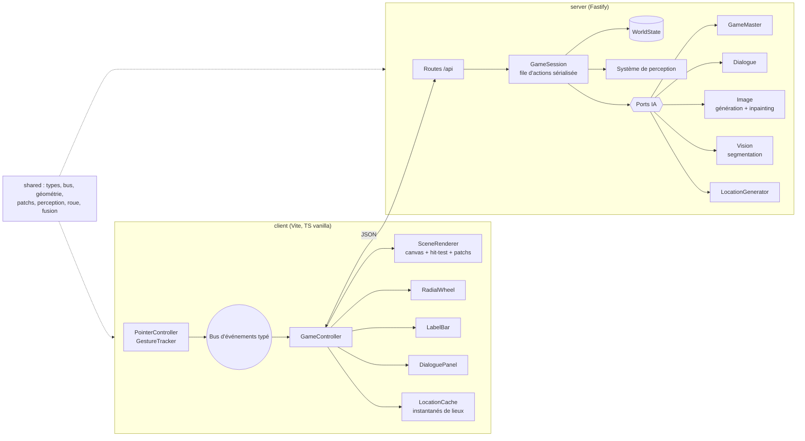

# Point-and-click IA — socle moteur

Un point-and-click où **rien n'est scripté** : chaque élément visible de la scène est sélectionnable,
un **maître du jeu IA** propose des actions contextuelles et les interprète contre l'état du monde,
les **personnages** répondent avec leur propre mémoire et ne savent que ce qu'ils ont perçu, et l'image
de la scène est **retouchée localement** (inpainting) quand le monde change.

Cette première version pose le moteur générique : tout fonctionne **hors ligne** grâce à des
fournisseurs IA *mock* déterministes, et les vrais adaptateurs (LLM compatible OpenAI/xAI, API d'image)
sont des stubs documentés prêts à être branchés.

## Interaction

| Geste | Effet |
|---|---|
| **Tap / clic** sur un élément | son nom (et sa narration) s'affiche dans la barre du bas |
| **Appui long** (~400 ms) | ouvre une **roue radiale** de ≤ 6 actions générées par l'IA pour cet élément |
| **Glisser** vers une action puis **relâcher** | exécute l'action |
| Relâcher **au centre** | annule |
| Bouton ◎ | affiche le contour de tous les éléments détectés |
| Bouton 💬 | ouvre le journal des dialogues |

Fonctionne au doigt (Pointer Events + capture) comme à la souris. Sur téléphone, le mode paysage est
recommandé : l'image est affichée en entier (« contain ») pour que chaque élément reste atteignable.

## Lancer

Prérequis : Node ≥ 20.

```bash
cd point-and-click-ia
npm install
npm run dev        # serveur http://127.0.0.1:8787 + client Vite http://localhost:5173
```

Ouvrir http://localhost:5173 (le client relaie `/api` vers le serveur).

```bash
npm test           # Vitest : shared + server + client
npm run build      # typecheck des 3 paquets + bundle serveur (esbuild) + client (Vite)
npm start          # sert l'API et le client buildé (client/dist) sur :8787
```

Sans fichier `.env`, tout tourne en **mode mock** (aucune clé, aucun réseau).

## Architecture



### Boucle d'une action

1. Appui long → `GET /api/actions` : le MJ propose ≤ 6 actions pour l'élément (cache par état).
2. Choix → `POST /api/act` : le MJ (omniscient) renvoie un **patch d'état** (`PatchOp[]`), des
   **événements du monde**, une narration et éventuellement une **demande de retouche d'image**.
3. Le moteur applique le patch (`applyPatch`, pur, avec avertissements au lieu d'exceptions).
4. Les événements passent par le **système de perception** : chaque personnage présent les mémorise
   selon ce qu'il peut *voir* / *entendre* (un personnage endormi n'entend que les bruits forts ; un
   événement `hidden` n'est perçu par personne).
5. Si l'image change : **inpainting de la seule région** concernée → **ré-analyse de cette région**
   uniquement par la vision → fusion des éléments (`mergeRegionElements` : seuls les éléments dont le
   centre est dans la région sont remplacés, les ids sont conservés quand c'est le même objet).
6. Les personnages qui ont perçu un événement saillant **réagissent** (une réplique max chacun).
7. Le client ne redessine que le rectangle du patch d'image (flash vert pointillé en debug).

### Dialogues diégétiques

Le fournisseur de dialogue ne reçoit **jamais** le `WorldState` : uniquement une `CharacterPerspective`
(fiche du personnage, sa mémoire, ce qu'il voit autour de lui, l'historique de la conversation).
Un personnage absent lors d'un événement ne peut donc pas en parler.

### Voyages

Franchir une sortie sans destination **génère un nouveau lieu cohérent** avec le précédent (image,
éléments, personnages, sortie de retour). Revenir sur ses pas **restaure le lieu sauvegardé** (même
image, même état) côté serveur ; le client garde aussi un instantané du canvas pour un retour immédiat.

## Arborescence

```
point-and-click-ia/
├── shared/src/        types du monde & API, bus d'événements, géométrie (hit-test, letterbox),
│                      patchs d'état, perception, maths de la roue radiale, fusion de régions, français
├── server/
│   ├── .env.example   configuration des fournisseurs (copier en .env, jamais commité)
│   └── src/
│       ├── app.ts                 routes Fastify (schémas JSON)
│       ├── engine/                GameSession, perception, sessions, stockage d'images, vues
│       └── providers/
│           ├── ports.ts           interfaces GameMaster / Dialogue / Image / Vision / LocationGenerator
│           ├── mock/              implémentations hors ligne déterministes (SVG, thèmes, MJ à règles)
│           ├── llm/               client OpenAI-compatible + prompts + adaptateurs (stubs)
│           └── image/             adaptateurs HTTP image / vision (stubs)
└── client/src/
    ├── input/         GestureTracker (machine à états pure) + PointerController
    ├── scene/         SceneRenderer (composition canvas, patchs partiels, contours, sélection)
    ├── ui/            RadialWheel, LabelBar, DialoguePanel
    └── game/          GameController, LocationCache
```

## API

| Méthode | Route | Rôle |
|---|---|---|
| POST | `/api/session` | crée une partie, renvoie la vue du lieu initial |
| GET | `/api/actions?sessionId=&elementId=` | ≤ 6 actions contextuelles |
| POST | `/api/act` | exécute une action (monde, parler, voyager) |
| POST | `/api/talk` | réplique du joueur à un personnage |
| POST | `/api/travel` | emprunte une sortie |
| GET | `/api/image/:id` | image de scène ou de patch |
| POST | `/api/save` | sauvegarde JSON du monde (si `SAVE_DIR`) |
| GET | `/api/state` | état complet (debug, à protéger avant toute mise en ligne) |

## Brancher de vrais fournisseurs

1. `cp server/.env.example server/.env` puis renseigner les clés (le fichier `.env` est ignoré par git).
2. Texte : `TEXT_PROVIDER=llm`, `LLM_BASE_URL=https://api.x.ai/v1`, `LLM_API_KEY=…`, `LLM_MODEL=grok-4`
   (tout endpoint `/chat/completions` compatible OpenAI convient).
3. Image / vision : `IMAGE_PROVIDER=http`, `IMAGE_BASE_URL`, `IMAGE_API_KEY`, `IMAGE_MODEL`, `VISION_MODEL`.
4. Implémenter les méthodes marquées `NotImplementedError` dans
   `server/src/providers/llm/adapters.ts` et `server/src/providers/image/httpAdapters.ts`.
   Les prompts (`llm/prompts.ts`) et le client JSON (`llm/openaiCompatibleClient.ts`) sont déjà prêts ;
   il reste à valider les réponses (schéma) et à convertir masques / bbox au format attendu par l'API choisie.

La sélection se fait dans `server/src/providers/index.ts` (`createProviders`).

## Ce qui est mocké

- **MJ** : règles par tags/état (examiner, ouvrir/fermer, allumer, fouiller, prendre, casser, frapper,
  écouter, boire, réveiller, donner…), sans LLM.
- **Image** : scènes vectorielles SVG générées à partir d'une disposition ; l'« inpainting » re-rend la
  même scène découpée sur la région modifiée.
- **Vision** : relit la disposition connue au lieu d'analyser des pixels.
- **Lieux** : 4 thèmes (taverne de départ, ruelle, cave, jardin) enchaînés de façon déterministe.
- **Dialogues** : réponses construites à partir de la mémoire perçue du personnage.
- Images en mémoire uniquement ; la sauvegarde ne contient que le `WorldState`.

## Feuille de route

- [ ] Adaptateurs réels : LLM (MJ, dialogues, lieux) avec validation de schéma, image (inpainting
      avec masque), vision (segmentation + noms)
- [ ] Streaming des narrations et des répliques ; indicateur de latence
- [ ] Persistance des images et chargement de partie
- [ ] Inventaire interactif (utiliser un objet sur un élément de la scène)
- [ ] Objectifs émergents et journal de quête générés par le MJ
- [ ] Accessibilité : navigation clavier dans la roue, lecteur d'écran pour la barre de libellé
- [ ] Authentification / limitation de débit avant toute mise en ligne
